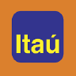
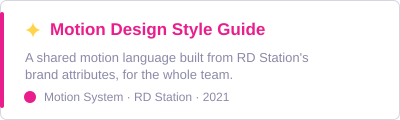
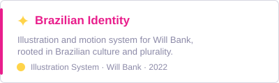
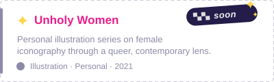
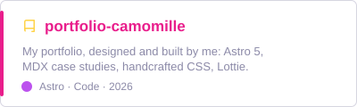

  <a href="https://camomille-artwork.com"> `` &lt;img src="./profile/banner.svg" width="100%" alt="camomille artwork" /&gt; ``</a>

<h1 align="center">Camila Santos · camomille</h1>

<h3 align="center">I design how products <em>move</em>, <em>feel</em>, and <em>respond</em>.</h3>

Product & Motion Designer · São Paulo, Brazil

  
  
  
  
  

I design how digital products move, feel, and respond. Since 2014 I have worked across UX/UI, motion, and illustration, with the eye of a product designer and the rigor of a front-end developer. I am currently a Product & Motion Designer at [Itaú Unibanco](https://github.com/itau).

My work lives where usability meets visual value: microinteractions, prototypes, and design systems that stay consistent as teams grow. I care deeply about accessibility and diversity in UX, and about interfaces that feel like they were made for the people who use them.

## ✨ What I do

- 🎞️ **Motion and microinteractions.** Motion languages, style guides, and interaction details that give a product its rhythm, built in After Effects, Lottie, and Rive.
- 🎨 **Illustration systems.** Visual identities and illustration libraries with clear rules, diverse representation, and room to scale.
- 🧩 **Design systems and prototyping.** Components, tokens, and high-fidelity prototypes in Figma and ProtoPie, measured against real user journeys.
- 💻 **Design that ships.** Hands-on HTML, CSS, and React, so what I design survives the handoff. My portfolio is hand-built in Astro.

## 🏢 Where I work

  
  <strong><a href="https://github.com/itau">Itaú Unibanco</a></strong>
   
  Product & Motion Designer, crafting interfaces and motion for digital banking products.

 

## 🚀 Selected work

  
  

  
  

- **[Motion Design Style Guide](https://camomille-artwork.com/work/rd-station), RD Station (2021).** RD's new brand had style guides for UI, illustration, and graphics, but none for motion. I translated its five brand attributes into a motion language that any designer on the team could pick up, and it outlived the rebrand itself.
- **[Brazilian Identity](https://camomille-artwork.com/work/will-bank), Will Bank (2022).** An illustration and motion system for a bank app with no visual identity of its own. Grounded in research with the team and clients (88.6% of respondents did not feel represented by how other local apps portray Brazilian culture), it uses the brand's circle as a visual stage, an expanded skin-tone and hair palette, and four illustration categories.
- **Unholy Women (coming soon).** A personal illustration series exploring female iconography through a queer, contemporary lens.
- **[portfolio-camomille](https://github.com/camomiIIe/portfolio-camomille).** My portfolio, designed and built by me. Astro 5, MDX case studies, handcrafted CSS with design tokens, and Lottie for motion.

## 🛠️ Toolkit

**Design and prototyping**

**Motion**

**Front-end**

## 📊 GitHub activity

  
  

  

## 🎧 On repeat

Music shapes how I think about rhythm and timing, and it is always playing while I work.

  

## 🤝 Working together

Alongside my full-time role, I take on a small number of freelance projects and I am open to new opportunities: motion design and Lottie animation, illustration and illustration systems, design systems, and interactive prototyping. I work remotely from São Paulo, with working hours that overlap with both the Americas and Europe.

Got a project? Let's talk. Write to [camicristdosantos@gmail.com](mailto:camicristdosantos@gmail.com) or message me on [LinkedIn](https://www.linkedin.com/in/camilasantos1294/).
